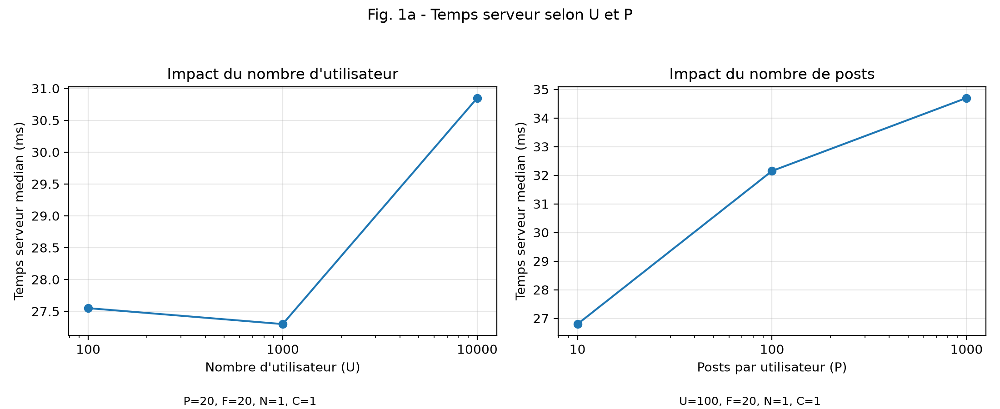
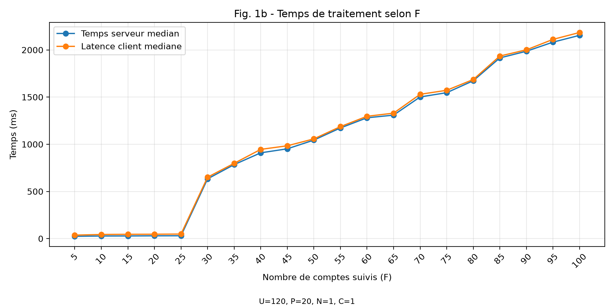
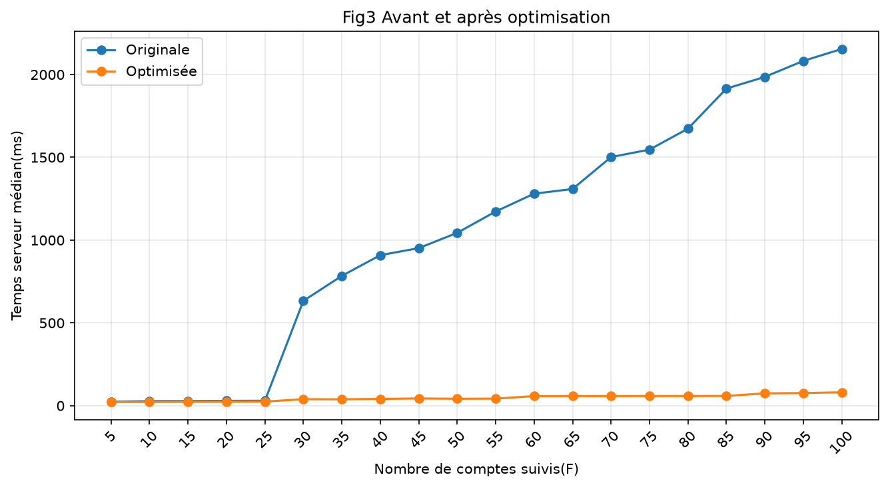
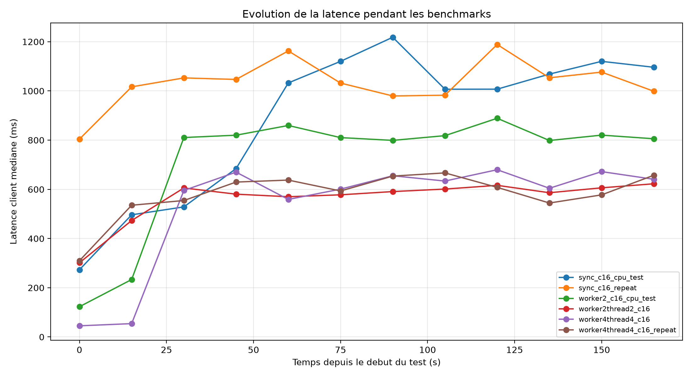
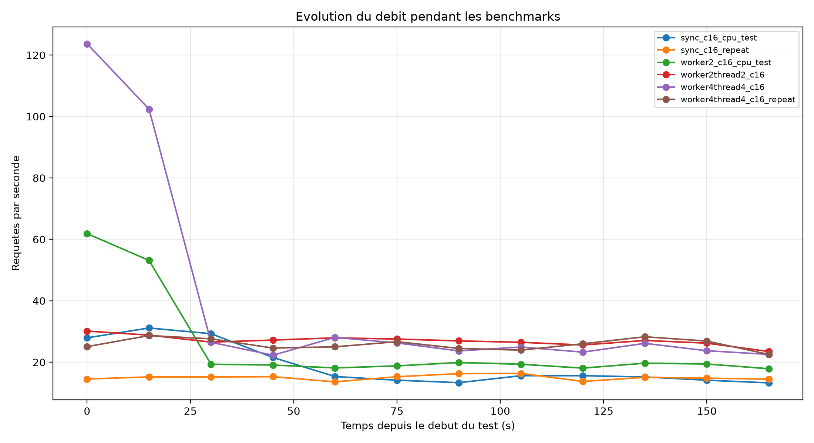

# TinyInsta passe-t-elle à l'échelle ?
Projet Données Massives et Cloud  2026

## Introduction

TinyInsta est une application de réseau social développé avec Flask et déployée sur Google App Engine, utilisant Google Cloud Datastore pour stocker les données. Elle permet notamment de consulter une timeline contenant les publications récentes des comptes suivis.

L'objectif de cette étude est de répondre à une question, **TinyInsta peut-elle maintenir des performances satisfaisantes lorsque le volume de données et la charge augmentent?**

Pour y répondre, j'ai étudié deux aspects de la scalabilité, soit :

- **Scalabilité des données :** capacité à gérer davantage de données sans dégradation disproportionnée des performances. J'étudie trois paramètres : **U** (nombre d'utilisateurs), **P** (publications par utilisateur) et **F** (comptes suivis par utilisateur).
- **Scalabilité des ressources:** capacité à exploiter des ressources supplémentaires pour traiter davantage de requêtes.J'analyse l'influence de **N** (nombre d'instances applicatives) et de **C** (nombre de clients concurrents) sur le débit et la latence.

## Démarche expérimentale

Pour étudier la scalabilité de TinyInsta, j'ai réalisé plusieurs benchmarks avec Locust sur l'endpoint `GET /api/timeline?user=…`.

J'ai organisé mon travail en trois parties:

1. **Coût d'une requête :** mesurer l'influence de U, P et F sur la latence, avec une seule instance et un client concurrent.
2. **Capacité et passage à l'échelle :** observer l'évolution du débit et de la latence en augmentant la concurrence, avec 1, 2 puis 4 instances B1.
3. **Optimisation :** identifier un goulot d'étranglement et chercher à le corriger. Plutôt que d'ajouter des ressources, j'ai choisi d'améliorer la stratégie de requêtage de l'application. J'ai également exploré un second goulot d'étranglement,mais le temps disponible ne m'a pas permis d'en identifier précisément l'origine. Je présente néanmoins les résultats de mes investigations.

Pour chaque partie, j'ai formulé des hypothèses, réalisé les mesures, puis analysé les résultats. J'ai également conservé les données brutes au format CSV afin de pouvoir vérifier mes observations et générer les figures.

## Indicateurs de performance

Pour analyser les résultats, j'ai utilisé plusieurs indicateurs:

- **Temps serveur (`SERVER_MS`) :** durée d'exécution de `get_timeline()`,mesurée directement par l'application et transmise via l'entête HTTP `Server-Timing`
- **Latence client (`LATENCY_MS`) :** temps total mesuré par Locust entre l'envoi d'une requête et la réception de sa réponse
- **Débit (*throughput*) :** nombre de requêtes réussies par seconde(req/s).
- **Concurrence (C) :** nombre de clients virtuels Locust sollicitant l'application simultanément

Pour les latences, j'ai principalement utilisé la **médiane**, car elle est moins sensible aux valeurs extrêmes que la moyenne.

Enfin, la différence entre la latence client et le temps serveur ne représente pas uniquement le réseau : elle peut également comprendre l'attente des requêtes, le traitement HTTP et la sérialisation des réponses.
## 1. Montage expérimental
 
### 1.1 Architecture de TinyInsta

TinyInsta utilise Flask et Gunicorn pour traiter les requêtes HTTP, tandis que les données sont stockées dans Google Cloud Datastore.

Mon étude se concentre sur l'endpoint `GET /api/timeline?user=…`, qui permet de récupérer les 20 publications les plus récentes de l'utilisateur et des comptes qu'il suit.

La fonction `get_timeline()` fonctionne de la manière suivante :

1. **Récupération de l'utilisateur :** elle récupère l'entité `User` dans Datastore.
2. **Identification des auteurs :** elle consulte la liste des comptes suivis (`follows`), ajoute l'utilisateur lui-même et supprime les doublons.
3. **Recherche des publications :** elle tente d'abord une requête GQL utilisant l'opérateur `IN`, avec un tri chronologique décroissant et une limite de 20 publications. En cas d'échec, une requête équivalente est tentée avec l'API Datastore.
4. **Mécanisme de repli (*fallback*) :** si les deux requêtes échouent, une requête individuelle est effectuée pour chaque auteur. Les publications sont ensuite regroupées, triées par date et limitées aux 20 plus récentes.

Les publications sélectionnées sont finalement renvoyées au client sous forme de réponse HTTP.


### 1.2 Environnement Google Cloud

Les expérimentations ont été réalisées sur Google Cloud Platform, en utilisant principalement deux services: Google App Engine pour l'hébergement de l'application et Google Cloud Datastore pour le stockage des données. J'ai également pu utiliser Google Cloud Metric Explorer comme outil de diagnostic. Afin de regarder l'utilisation CPU , ainsi que la consommation de mégacycles pendant des experiences en rapport avec la partie 3. 

#### Google App Engine

Google App Engine est un service de type Platform as a Service (PaaS), permettant de déployer une application sans administrer directement l'infrastructure sous-jacente. Le fournisseur prend en charge la gestion des serveurs et de l'environnement d'exécution, tandis que le développeur se concentre sur son application et sa configuration.

Pour nos expériences,  j'ai principalement utilisé des instances B1, avec une mise à l'échelle manuelle (manual scaling), afin de fixer leur nombre et de comparer les performances sous différentes charges. Des instances B2, disposant de davantage de ressources, ont également été utilisées lors des investigations complémentaires.

#### Google Cloud Datastore

Comme vu avant, Google Cloud Datastore est une base de données NoSQL entièrement gérée, utilisée par TinyInsta pour stocker les utilisateurs (User) et les publications (Post). 

Contrairement à App Engine, je ne contrôle pas directement les ressources internes de Datastore.Cette distinction est importante pour notre étude, augmenter les ressources applicatives ne garantit pas une augmentation proportionnelle des performances, puisque celles-ci dépendent également des accès aux données.

### 1.3 Versions et configurations déployées

Afin de comparer les performances de TinyInsta dans des conditions contrôlées, plusieurs versions de l'application ont été déployées sur Google App Engine.

L'objectif était de distinguer les effets du **volume de données**, de la **concurrence** et du **nombre d'instances**, tout en conservant des configurations comparables entre les expériences.

#### Configurations principales

| Version | Classe | Scaling | Instances | Utilisation |
|---|---|---|---|---|
| `default` | F1 | Automatique | Variable | Application principale accessible publiquement |
| `fixed1` | B1 | Manuel | 1 | Parties 1 et 2 |
| `fixed2` | B1 | Manuel | 2 | Partie 2 |
| `fixed4` | B1 | Manuel | 4 | Partie 2 |
| `batched1` | B1 | Manuel | 1 | Partie 3 : version optimisée |

Les versions `fixed1`, `fixed2` et `fixed4` utilisent la même classe d'instance B1.Seul le nombre d'instances allouées varie, permettant d'étudier la **scalabilité horizontale**,c'est-à-dire l'augmentation de la capacité de traitement par ajout d'instances. La version `batched1` a été utilisée pour tester une modification de l'algorithme de génération des timelines. Elle conserve une instance B1 afin de comparer ses performances à celles de `fixed1` sans modifier les ressources applicatives.

#### Configuration du serveur applicatif

Les benchmarks principaux utilisent Gunicorn avec un seul processus de travail synchrone par instance, conformément à la configuration suivante:

```bash
gunicorn --workers 1 --worker-class sync -b :$PORT main:app
```
Un worker synchrone traite une requête à la fois. Cette configuration permet d'étudier le comportement de l'application avec un niveau de concurrence interne fixé, tout en faisant varier le nombre d'instances App Engine.

#### Isolation des déploiements

Les versions expérimentales ont été déployées avec l'option `--no-promote`,afin de ne pas modifier la répartition du trafic de la version principale `default`.Chaque version disposait ainsi de sa propre URL, permettant à Locust de cibler explicitement la configuration à mesurer. Les versions expérimentales ont été arrêtées après les benchmarks afin de limiter le coût.

#### Vérification des instances réellement utilisées

Afin de vérifier que les instances configurées participaient réellement au traitement des requêtes, j'ai pu analysé l'entête HTTP X-Instance dans les journaux Locust.Les identifiants relevés ont confirmé l'utilisation de :

- **1 instance distincte** pour `fixed1`
- **2 instances distinctes** pour `fixed2`
- **4 instances distinctes** pour `fixed4`

### 1.4 Jeux de données : U, P et F

j'ai utilisé plusieurs jeux de données en faisant varier les paramètres U, P et F, définis précédemment.

L'augmentation de U et P accroît principalement le volume de données stockées, tandis que F influence directement le nombre d'auteurs à interroger pour construire une timeline.

Le nombre théorique de publications stocké est donné par:

$$
N_{\text{posts}} = U \times P
$$

#### Principe de variation contrôlée

Afin d'isoler l'influence de chaque paramètre, j'ai appliqué le principe de variation d'un seul facteur à la fois. 
Lorsqu'un paramètre varie, les autres sont maintenus constants. Cette méthode permet de comparer les mesures dans des conditions homogènes.

### 1.5 Outils et protocole de mesure

Les benchmarks ont été réalisés avec **Locust**, un outil de test de charge permettant de simuler des clients concurrents.Le script `bench/locustfile.py` envoie des requêtes à l'endpoint `GET /api/timeline?user=…`.

Les tests fonctionnent en **boucle fermée** : chaque client virtuel attend la réponse avant d'envoyer une nouvelle requête. Le débit dépend donc du nombre de clients actifs et du temps de réponse de l'application.

Pour les expériences principales, j'ai retenu :

- **Durée:** 45 secondes par benchmark.
- **Concurrence:** C = 1 pour les parties 1 et 3 ; C appartenant à {1, 2, 4, 8, 16, 32, 64} pour la partie 2.
- **Infrastructure:** versions App Engine configurées avec un nombre fixe d'instance.

Des tests complémentaires de 180 secondes ont également été réalisés lors des investigations de la troisième partie.

#### Instrumentation et collecte des mesures

L'application expose deux en-têtes HTTP :

- `Server-Timing`: mesure la durée d'exécution de `get_timeline()` en millisecondes.
- `X-Instance`: identifie l'instance ayant traité la requête.

Locust mesure parallèlement la **latence client**, qui comprend l'ensemble du temps de réponse HTTP, contrairement au temps serveur limité à `get_timeline()`.

Chaque requête est enregistrée dans un fichier CSV contenant notamment son statut HTTP, sa latence client (`LATENCY_MS`), son temps serveur (`SERVER_MS`), son instance (`INSTANCE`) et les éventuelles erreurs (`ERROR`).

Les scripts Python exploitent ces données pour calculer les médianes des latences, le débit en requêtes réussies par seconde, le nombre d'échecs et les instances distinctes observées. Pour la partie 2, le débit correspond au nombre de réponses HTTP 200 divisé par les 45 secondes du benchmark.

Chaque expérience consiste à préparer le jeu de données, sélectionner la configuration App Engine, exécuter Locust, conserver les mesures brutes puis analyser les résultats. Les limites sont discutée dans la section 4. 

### 1.6 Organisation du dépôt et reproductibilité

Le dépôt Git contient le code de TinyInsta, les configurations de déploiement, les données expérimentales et les outils d'analyse :

- `bench/` : génération des données et benchmarks Locust.
- `raw/` : journaux bruts des expériences.
- `analysis/` : scripts d'analyse et de génération des figures.
- `figures/` : graphiques et résultats agrégés.

Les cinq figures obligatoires peuvent être régénérées depuis la racine du dépôt avec :

```bash
bash analysis/generate_all_fig.sh
```

Cette commande permet de reproduire les analyses à partir des mesures enregistrées, sans relancer les benchmarks sur Google Cloud.


#### Configuration de l'environnement

Les expérimentations ont été réalisées sur le projet Google Cloud `massive-data-project-513113`, dans la région `europe-west9` (Paris).
```
callumpye05@cloudshell:~/tinyinsta-2026 (massive-data-project-513113)$ gcloud app describe --format="value(locationId)"
europe-west
```

J'ai déployé plusieurs versions de TinyInsta sur App Engine afin de comparer différentes configurations, sans modifier la version principale de l'application.

Les mesures ont été réalisées entre octobre et novembre 2026, à l'aide de Locust.

Pour générer la charge, j'ai utilisé **Locust depuis Google Cloud Shell**. Les requêtes étaient donc envoyées depuis cet environnement distant et non depuis mon ordinateur personnel.


## 2. Résultats expérimentaux

### 2.1 Partie 1 — Le coût d'une requête

### 2.1.1 Hypothèses sur U, P et F

Avant de réaliser les benchmarks, j'ai formulé trois hypothèses concernant l'influence des paramètres U, P et F sur les performances de la génération d'une timeline.
Ces hypothèses reposent sur l'analyse de la fonction `get_timeline()`, notamment sur les requêtes Datastore, l'utilisation du filtre `IN`, le tri chronologique et la limitation des résultats.

#### 1er hypothèse: Influence du nombre d'utilisateurs(U) ####
Je supposais que l'augmentation de U n'affectera pas significativement la latence d'une timeline.
En effet, l'application n'a pas besoin de charger les publications de tous les utilisateurs à chaque requête. Elle recherche uniquement celles des comptes suivis par l'utilisateur concerné.

Ce comportement est visible dans get_timeline():

```
follow_key = client.key('User', user)
user_entity = client.get(follow_key)
```

La fonction construit ensuite la liste des auteurs concernés à partir des comptes suivis (follows). Ainsi, lorsque P et F restent constants, l'augmentation de U ne devrait pas entraîner une dégradation importante des performances.

#### Second hypothèse: Influence du nombre de publications(P) ####
Je supposais que l'augmentation de P entraînera une croissance du volume de données stockées et des coûts de stockage, mais que son influence sur la latence restera modérée.
En effet,les publications sont récupérées à l'aide de requêtes ordonnées par date,avec une limite de 20 résultats.Si les index Datastore sont exploités efficacement, l'application n'a pas besoin de parcourir toutes les publications pour construire une timeline.

```
query.order = ['-created']
timeline = list(query.fetch(limit=limit))
```

#### Troisième hypothèse : influence du nombre de comptes suivis (F) ####

Je supposais que l'augmentation de **F** pourrait entraîner une légère hausse de la latence, puisque davantage d'auteurs doivent être pris en compte lors de la construction d'une timeline.

Cependant, la fonction `get_timeline()` utilise des requêtes groupées avec l'opérateur `IN` et limite le résultat aux 20 publications les plus récentes. Je m'attendais donc à ce que les performances restent relativement stables, même lorsque le nombre de comptes suivis augmente.

Le mécanisme de repli, qui exécute une requête distincte par auteur, pourrait théoriquement entraîner une dégradation plus importante. Néanmoins, puisqu'il n'intervient qu'en cas d'échec des requêtes groupées, je ne m'attendais pas à ce qu'il influence les résultats dans des conditions normales.


#### 2.1.2 Protocole expérimental
Les expériences ont été réalisées sur la version fixed1 de TinyInsta, configurée avec une seule instance B1 et un seul client concurrent Locust (C = 1). Chaque benchmark dure nominalement 45 secondes.

Les paramètres testés sont les suivants :
U — Nombre d'utilisateurs 100, 1 000, 10 000 P = 20 ; F = 20
P — Publications par utilisateur 10, 100, 1 000	U = 1 000 ; F = 20
F — Comptes suivis	5, 10, 15, …, 100 U = 120 ; P = 20

Les résultats des variations de U et P sont présentés dans la figure 1a, tandis que ceux de F figurent dans la figure 1b.
Enfin, les journaux bruts permettent de vérifier les codes HTTP, les éventuelles erreurs et le nombre d'instances réellement sollicitées grâce à l'entete X-Instance.

##### 2.1.3 Influence de U et P — Figure 1a #####




La figure 1a présente l'évolution du temps serveur médian, exprimé en millisecondes, lorsque le nombre d'utilisateurs **U** ou le nombre de publications par utilisateur **P** augmente.

##### Influence du nombre d'utilisateurs (U) #####

| U | Temps serveur médian |
|---:|---:|
| 100 | 27,55 ms |
| 1 000 | 27,30 ms |
| 10 000 | 30,85 ms |

Lorsque U passe de 100 à 10 000, soit une multiplication par 100, la latence serveur passe de 27,55 ms à 30,85 ms. Cela représente une augmentation d'environ 12 %.

Nous observons donc une relative stabilité du temps d'exécution malgré une augmentation importante du nombre d'utilisateurs.

Ce comportement est cohérent avec notre hypothèse H1: la fonction get_timeline() récupère les publications d'un ensemble déterminé de comptes suivis, et non celles de l'ensemble des utilisateurs de la base. L'augmentation de U n'entraîne donc pas directement une augmentation proportionnelle du nombre d'auteurs consultés.

Les variations observées peuvent également refléter la variabilité des temps de réponse de l'infrastructure Cloud. Les mesures ne permettent pas d'attribuer avec certitude la totalité des écarts à l'augmentation de U.

##### Influence du nombre de publications (P) #####

| P | Temps serveur médian |
|---:|---:|
| 10 | 26,80 ms |
| 100 | 32,15 ms |
| 1 000 | 34,70 ms |

Lorsque P passe de 10 à 1 000 (×100), la latence serveur augmente de **26,80 ms à 34,70 ms**, soit environ **29,5 %**. Cette progression reste modérée par rapport à l'augmentation du volume de données.

Ce résultat est cohérent avec notre hypothèse H2 : `get_timeline()` utilise des requêtes ordonnées chronologiquement et limitées aux 20 publications les plus récentes. Les index Datastore peuvent ainsi limiter le travail nécessaire à leur récupération.
Cependant, je ne peux pas déterminer précisément les causes de cette hausse de latence à partir de ces seules mesures.

**Conclusion  Figure 1a**

Les résultats sont globalement compatibles avec nos deux hypothèses :

- **H1 :** l'augmentation de U a un impact limité sur la latence.
- **H2 :** l'augmentation de P entraîne une hausse modérée, non proportionnelle au volume de données.

TinyInsta présente donc une **bonne stabilité de la latence serveur vis-à-vis de U et P**, dans les conditions testées. Ces observations restent toutefois partielles et ne suffisent pas à établir la scalabilité globale de l'application.


#### 2.1.4 Influence de F — Figure 1b ####



La troisième hypothèse (H3) prévoyait une augmentation relativement modérée de la latence avec F. je suppose que les requêtes groupées avec l'opérateur `IN` permettraient de récupérer les publications de plusieurs auteurs sans multiplier les requêtes.

Les mesures révèlent un comportement différent. 

| F | Temps serveur médian | Latence client médiane |
|---:|---:|---:|
| 5 | 24,10 ms | 36,50 ms |
| 20 | 29,40 ms | 46,20 ms |
| 25 | 30,00 ms | 48,00 ms |
| 30 | 633,30 ms | 650,80 ms |
| 50 | 1 044,10 ms | 1 056,90 ms |
| 100 | 2 154,55 ms | 2 184,70 ms |

Jusqu'à **F = 25**, la latence serveur reste relativement stable, autour de 24 à 30 ms. En revanche, à **F = 30**, elle atteint **633,30 ms**, soit plus de **21 fois** la valeur mesurée pour F =25.

Cette dégradation se poursuit ensuite: à F = 100, le temps serveur médian dépasse **2,15 secondes**. La latence client suit la même tendance, ce qui indique que l'essentiel de cette augmentation se produit pendant l'exécution de `get_timeline()`.

Ces résultats contredisent donc notre hypothèse initiale : l'augmentation de F ne provoque pas uniquement une légère hausse de la latence, mais révèle un changement brutal dans le comportement de l'application.

**Recherche de la cause**

L'examen du code montre que `get_timeline()` tente d'abord de récupérer les publications à l'aide de requêtes groupées utilisant l'opérateur `IN`.

Or, selon la [documentation Google Cloud](https://docs.cloud.google.com/datastore/docs/concepts/queries#in), les requêtes Datastore sont limitées à **30 disjonctions**.

La fonction ajoute également l'utilisateur lui-même aux comptes suivis :

```python
follows = list({*follows, user})
```

Ainsi, pour F =30, la liste peut contenir **31 auteurs distincts**, dépassant la limite.

Lorsque les requêtes groupées échouent, le code éxecute le mécanisme de repli exécutant une requête distincte pour chaque auteur. Cette stratégie multiplie les accès à Datastore et fournit une explication cohérente de l'augmentation brutale observée. 

Afin de chercher des preuve supplementaire , j'ai crée un script simple qui simule 30 requêtes Datastore individuelles depuis Google Cloud Shell, sur cinq auteurs différents.

Lors d'une seconde série de mesures, j'ai obtenu une durée moyenne de 14,65 ms et une médiane de 12,30 ms par requête. À titre indicatif, l'exécution séquentielle de 101 requêtes représenterait donc environ 1,48 seconde, hors surcoûts supplémentaires, contre 2,15 secondes de temps serveur médian observé pour F = 100.

Cet ordre de grandeur, associé à la progression approximativement linéaire de la latence après F = 30, renforce l'hypothèse d'un passage aux requêtes individuelles. Toutefois, les mesures ayant été effectuées depuis Cloud Shell et non depuis les instances App Engine, cette comparaison reste indicative et ne constitue pas une preuve directe de l'activation du mécanisme de repli. Les résultats sont disponible dans raw/part1/individual_query_latency.csv


**Conclusion — Figure 1b**

Les résultats contredisent notre hypothèse initiale H3: contrairement à nos attentes, l'augmentation de F provoque une dégradation brutale des performances à partir de F = 30.

L'analyse du code, des contraintes de Datastore et des mesures complémentaires suggère fortement que cette rupture provient de l'activation du mécanisme de repli, qui multiplie les requêtes individuelles.


**Part de la latence liée au réseau**

J'ai comparé la latence client au temps d'exécution de `get_timeline()` afin d'estimer le temps passé en dehors de cette fonction.
Par exemple, pour F =20, la latence client médiane est de 46,20 ms, contre 29,40 ms côté serveur,soit un écart de 16,80 ms(environ 36,4 % de la latence client).

Cependant, cet écart ne correspond pas uniquement au réseau car il peut également comprendre l'attente des requêtes et le traitement HTTP. Je ne peux donc pas déterminer précisément la part due au réseau avec les mesures disponibles.


#### 2.1.5 Lectures Datastore et coût d'un million de timelines


Le nombre d'opérations Datastore dépend fortement de la stratégie de requête utilisée. J'ai donc estimé le nombre d'entités récupérées pour une timeline, en supposant que chaque auteur possède au moins 20 publications.

Lorsque la requête groupée fonctionne, l'application récupère au maximum 21 entités soit un utilisateur et 20 publications.
En revanche, lorsque le mécanisme de repli est déclenché, le nombre maximal d'entités récupérées,noté R(F),devient :

$$
R(F)=1+20(F+1)
$$

Cette formule correspond à une entité User, puis 20 publications au maximum pour chacun des F comptes suivis et l'utilisateur lui-même.
Pour F = 30, cela représente jusqu'à 621 entités, contre 21 lorsque la requête groupée fonctionne. Soit environ 30x plus d'entité. 


Afin d'estimer le coût des lectures Datastore, je m'appuie sur la [grille tarifaire officielle de Google Cloud Datastore](https://cloud.google.com/datastore/pricing), pour la région **Paris (`europe-west9`)**. Cette valeur est de 0,036 USD pour 100 000 lectures d'entités, avec 50 000 lectures gratuites par jour et par projet.

En supposant que chaque auteur possède au moins 20 publications, le nombre maximal d'entités récupérées pour une timeline peut être estimé par :

$$
R(F) =
\begin{cases}
21 & \text{si } F \leq 29 \\[6pt]
1 + 20(F + 1) & \text{si } F \geq 30
\end{cases}
$$

soit : 

$$
C(F)=\frac{10^6 \times R(F)}{100,000}\times 0{,}036
$$

| Configuration      | Lectures estimées par timeline | Le cout théorique pour 1 million |
|--------------------|-------------------------------:|------------------------------:|
| U variable, F = 20 |                             21 |                      7,56 USD |
| P variable, F = 20 |                             21 |                      7,56 USD |
| F = 5 à 25         |                             21 |                      7,56 USD |
| F = 30             |                            621 |                    223,56 USD |
| F = 50             |                          1 021 |                    367,56 USD |
| F = 100            |                          2 021 |                    727,56 USD |

Ces valeurs représentent des estimations théoriques, fondées sur le nombre maximal d'entités retournées selon la stratégie de requêtage utilisée. Elles ne tiennent pas compte de tous les mécanismes de facturation de Datastore, notamment des lectures d'index, et ne correspondent pas aux coût réellement mesurés.

Cette analyse montre qu'un passage de la requête groupée aux requêtes individuelles pourrait entraîner une augmentation importante du nombre de lectures et, par conséquent, du coût des opérations Datastore.

#### Conclusion partie 1 

Les résultats montrent que TinyInsta conserve des performances relativement stables lorsque U et P augmentent, mais présente une dégradation majeure à partir de F = 30.

Cette rupture semble principalement liée à la stratégie de requêtage de get_timeline(), dont le mécanisme de repli multiplie les accès à Datastore. Elle révèle une limite de scalabilité qui pourrait également augmenter le coût des lectures.

La troisième partie examinera une optimisation de cette stratégie, afin de réduire le nombre de requêtes nécessaires à la génération d'une timeline.

### 2.2 Partie 2 — Capacité et passage à l'échelle

#### 2.2.1 Hypothèses sur le débit et les instances

Dans cette deuxième partie, je cherche à déterminer si TinyInsta est capable d'augmenter sa capacité de traitement lorsque davantage de ressources applicatives lui sont attribuées.

Contrairement à la première partie,je conserve ici un jeu de données constant et faisons varier le nombre de clients concurrents (C) ainsi que le nombre d'instances App Engine (N).

Nous formulons quatre hypothèses principales:

#### H1 - Influence de la concurrence sur le débit ####

Je suppose qu'une augmentation du nombre de clients concurrents entraînera d'abord une hausse du débit, puisque davantage de requêtes pourront être soumises à l'application. Cependant, je m'attends à ce que cette progression ralentisse lorsque les ressources disponibles approcheront de leur capacité maximale.

#### H2 - Saturation des ressources et évolution de la latence

Je suppose que chaque configuration possède une capacité de traitement limitée. Au-delà d'un certain niveau de concurrence, le débit devrait atteindre un plateau, tandis que la latence continuerait d'augmenter en raison de l'accumulation des requêtes en attente.

#### H3 - Scalabilité horizontale

Je suppose que l'ajout d'instances B1 permettra d'augmenter la capacité de traitement de TinyInsta. En théorie, doubler le nombre d'instances pourrait approximativement doubler le débit maximal. Toutefois, je ne m'attends pas à une progression parfaitement linéaire, notamment en raison des surcoûts d'infrastructure et de l'utilisation de services partagés comme Datastore.

#### H4 - Influence des opérations d'entrée/sortie

Je suppose que TinyInsta pourrait être davantage limitée par les opérations d'entrée/sortie que par la puissance de calcul.
En effet, `get_timeline()` effectue des lectures auprès de Datastore, un service distant.

Or, notre configuration de Gunicorn utilise un seul worker synchrone par instance. Selon la [documentation officielle de Gunicorn](https://gunicorn.org/design/#sync-workers),un worker synchrone ne traite qu'une requête à la fois.

Ainsi, lorsqu'il attend une réponse de Datastore, il ne peut pas traiter une autre requête simultanément, ce qui pourrait contribuer à l'accumulation des requêtes en attente sous forte concurrence.

Je m'attends donc à ce qu'une forte concurrence provoque une accumulation de requêtes en attente, augmentant la latence client sans nécessairement augmenter proportionnellement le temps mesuré dans `get_timeline()`.

L'ajout d'instances pourrait atténuer cette attente en répartissant les requêtes. Toutefois, les seules mesures de débit et de latence ne permettront pas de confirmer avec certitude que l'application est principalement limitée par les I/O plutôt que par le CPU.

#### 2.2.2 Protocole expérimental

Pour tester ces hypothèses, j'ai conservé un jeu de données fixe (**U = 1 000, P = 20, F = 20**) et fait varier deux paramètres, le nombre de clients concurrents (**C**) et le nombre d'instances App Engine (**N**).

J'ai utilisé trois versions de TinyInsta,chacune configurée avec des instances B1 et une mise à l'échelle manuelle:

| Version | Instances (N) | Concurrence (C) |
|---|---:|---|
| `fixed1` | 1 | 1, 2, 4, 8, 16, 32, 64 |
| `fixed2` | 2 | 1, 2, 4, 8, 16, 32, 64 |
| `fixed4` | 4 | 1, 2, 4, 8, 16, 32, 64 |

Ça représente **21 configurations expérimentales**,avec un benchmark Locust de **45 secondes** pour chacune.

J'ai ensuite exploité les journaux CSV pour mesurer le **débit de requêtes réussies**, la **latence client** et le **temps serveur**, tout en vérifiant les erreurs et les instances réellement utilisées.

Les résultats sont présentés dans deux figures:

- **Figure 2a :** évolution du débit en fonction de C et N.
- **Figure 2b :** évolution de la latence client, avec une comparaison aux valeurs estimées à partir de la loi de Little.

Ce protocole doit permettre d'identifier les signes de saturation et de mesurer l'effet de l'ajout d'instances sur les performances.


#### 2.2.3 Débit et points de saturation — Figure 2a


La figure 2a présente l'évolution du débit de TinyInsta en fonction du nombre de clients concurrents **C**, pour 1, 2 et 4 instances B1.

| Clients (C) | N = 1 (req/s) | N = 2 (req/s) | N = 4 (req/s) |
|---:|---:|---:|---:|
| 1 | 20,67 | 19,40 | 19,31 |
| 2 | 21,96 | 33,40 | 41,91 |
| 4 | 21,02 | 38,53 | 65,02 |
| 8 | 21,60 | 41,20 | 75,02 |
| 16 | 25,56 | 43,93 | 84,78 |
| 32 | 26,33 | 44,36 | 91,80 |
| 64 | 27,40 | 44,62 | 93,56 |

**Évolution du débit et saturation**

Avec **N = 1**,je remarque que le débit reste relativement stable, autour de 20 à 22 req/s jusqu'à C =8, puis atteint seulement 27,40 req/s à C = 64. Augmenter la concurrence apporte donc peu de gains supplémentaires.

Avec **N = 2**, le débit atteint rapidement 41,20 req/s à C = 8, avant de se stabiliser autour de 44 req/s. Le plateau de saturation est ici plus visible.

Enfin, avec **N = 4**, le débit progresse davantage et atteint 93,56 req/s à C = 64. Sa croissance ralentit aux fortes concurrences, sans permettre d'affirmer qu'un plateau définitif a été atteint.

Cette progression limitée peut s'expliquer en partie par notre configuration Gunicorn : chaque instance dispose d'un seul worker synchrone, capable de traiter une requête à la fois, comme l'indique la [documentation officielle de Gunicorn](https://gunicorn.org/design/#sync-workers).


**Influence du nombre d'instances**

À C = 64, le débit passe de **27,40 req/s avec une instance à 93,56 req/s avec quatre instances**, soit une multiplication par **3,41**, contre un facteur théorique idéal de 4.

Ce résultat soutient mon hypothèse H3 :l'ajout d'instances améliore nettement la capacité de traitement, même si les gains ne sont pas parfaitement proportionnels aux ressources ajoutées.

Ce gain s'explique notamment par l'ajout de capacités de traitement : chaque instance B1 dispose de son propre worker Gunicorn synchrone, capable de traiter une requête à la fois. En multipliant les instances, plusieurs requêtes peuvent donc être traitées en parallèle.

La [documentation Google Cloud](https://docs.cloud.google.com/appengine/docs/standard/how-instances-are-managed) confirme qu'App Engine répartit les requêtes entre les instances disponibles.

Ces résultats sont globalement cohérents avec mes hypothèses H1, H2 et H3. La concurrence améliore initialement le débit, mais les gains diminuent lorsque la charge augmente, tandis que l'ajout d'instances permet d'augmenter la capacité de traitement.

Il reste cependant à examiner l'évolution de la latence pour déterminer les conséquences de cette augmentation de charge.

#### 2.2.4 Latence et loi de Little — Figure 2b


La figure 2b présente l'évolution de la latence client en fonction du nombre de clients concurrents **C**, pour les trois configurations étudiées : N = 1, 2 et 4 instances B1.

Nous constatons que la latence augmente avec le nombre de clients concurrents, mais que cette augmentation est nettement plus importante lorsque le nombre d'instances disponibles est faible.

**Application de la loi de Little**

Pour mieux comprendre le lien entre la concurrence, le débit et la latence, j'ai choisi d'utiliser la **loi de Little**, qui établit la relation suivante pour un système stable:

$$
L = \lambda \times W
$$

Ou :
- **L** représente le nombre moyen de requêtes présentes dans le système.
- **Lambda** représente le débit moyen, en requêtes par seconde.
- **W** représente le temps moyen de réponse, en secondes.

Dans mon expérience,chaque client virtuel Locust attend la réponse avant d'envoyer une nouvelle requête. J'ai donc approximé **L par C**, en supposant que les clients n'ont pas de temps d'attente significatif entre leurs requêtes.

Je peux ainsi estimer le temps de réponse moyen en divisant le nombre de clients concurrents par le débit mesuré.

Par exemple,pour **N = 1 et C = 64**, le débit est de 27,40 req/s:

$$
W \approx \frac{64}{27{,}40} \approx 2{,}34\ \text{s}
$$

J'ai ensuite comparé les estimations avec les latences réellement mesurées pour C = 64:

| Instances | Latence moyenne mesurée | Estimation de Little |
|---|---:|---:|
| N = 1 | 2 250,49 ms | 2 335,77 ms |
| N = 2 | 1 397,33 ms | 1 434,26 ms |
| N = 4 | 673,58 ms | 684,09 ms |

Les valeurs estimées sont relativement proches des moyennes mesurées. Cela montre que les résultats sont cohérents avec la relation entre concurrence, débit et temps de réponse décrite par la loi de Little.

par contre cette loi concerne les **moyennes** et non les **médianes**. De plus, les benchmarks ne sont pas nécessairement parfaitement stables pendant leurs 45 secondes, et l'approximation L ≈ C dépend du comportement des clients Locust.

**Interprétation**

Je remarque que lorsque le débit augmente peu malgré une forte hausse de la concurrence, la latence client devient beaucoup plus importante.

Une explication possible est la mise en attente des requêtes. En effet, chaque instance utilise un seul worker Gunicorn synchrone, qui ne peut traiter qu'une requête à la fois. Lorsque tous les workers sont occupés, les requêtes supplémentaires peuvent devoir attendre.

L'ajout d'instances permet de disposer de davantage de workers. Cela pourrait expliquer pourquoi, à C = 64, la latence médiane passe de **2 252,90 ms avec une instance à 553,65 ms avec quatre instances**, soit une réduction d'environ **75,4 %**.

Ces observations soutiennent donc l'hypothèse d'une saturation accompagnée d'une mise en attente des requêtes. En revanche, elles ne suffisent pas à démontrer que TinyInsta est principalement limitée par les opérations d'entrée/sortie plutôt que par le CPU.

**Conclusion — Figure 2b**

Je constate que l'augmentation de la concurrence peut entraîner une forte hausse de la latence lorsque le débit progresse peu. L'ajout d'instances améliore nettement les temps de réponse dans les conditions testées, mais ne permet pas à lui seul d'identifier la cause exacte des limitations observées.

**Bilan des points de saturation**

À partir des figures 2a et 2b, j'estime les niveaux de saturation suivant:

| Instances | Saturation estimée | Débit maximal observé |
|---|---|---:|
| N = 1 | Forte limitation dès les faibles concurrences | 27,40 req/s |
| N = 2 | Plateau visible vers C = 8 à 16 | 44,62 req/s |
| N = 4 | Ralentissement vers C = 32 à 64, sans plateau confirmé | 93,56 req/s |

Une instance B1 atteint donc un débit maximal observé de **27,40 req/s** dans cette expérience.Il ne s'agit toutefois pas d'une capacité maximale universelle, puisqu'elle dépend de la configuration Gunicorn et du travail effectué par chaque requête.

Le fait d'utiliser **un seul worker synchrone par instance** constitue une limite importante car ce worker ne traite qu'une requête à la fois. Les autres requêtes peuvent devoir attendre, même si je ne peux pas déterminer précisément si le CPU, les accès à Datastore ou la gestion des requêtes par App Engine constituent la limitation principale.

**Vérification de la loi de Little**

À C = 64, les temps de réponse moyens estimés par la loi de Little restent proches des mesures expérimentales, notamment pour N = 1 et N = 2, où les débits montrent des signes de saturation.

Cela confirme que mes résultats sont **compatibles avec la loi de Little**, sous l'hypothèse d'un système approximativement stable et de clients sans temps d'attente significatif entre leurs requêtes.

#### Limite du passage à l'échelle ####

Le passage de 1 à 4 instances multiplie le débit observé par **3,41 et non par 4** à C = 64.
Je constate donc une amélioration importante, mais non parfaitement linéaire. Les workers synchrones limitent la concurrence traitée par chaque instance, tandis que d'autres facteurs, notamment App Engine et Datastore, peuvent influencer le débit global.
Mes mesures ne permettent cependant pas d'identifier avec certitude le composant responsable de l'écart au facteur idéal de 4.


#### Limites de la configuration de Gunicorn

En regardant le script `deploy_fixed.sh`, j'ai remarqué que Gunicorn était lancé avec ses paramètres par défaut. 
Je pense qu'un goulot d'étranglement se situe probablement au niveau
de la configuration de Gunicorn.
D'après la [documentation officielle de Gunicorn](https://gunicorn.org/reference/settings/#workers),
le nombre de workers par défaut est de 1 et le type de worker est
synchrone(`sync`). En l'absence de configuration supplémentaire,
chaque instance ne peut donc traiter qu'une seule requête à la fois.

Cette configuration pourrait limiter le débit maximal de chaque
instance et expliquer en partie les performances observées lors
de la montée en charge.

#### 2.2.5 Limites de la scalabilité horizontale

Les résultats montrent que l'ajout d'instances améliore le débit et réduit la latence sous forte concurrence. Cependant, je considère que cette approche présente certaines limites.

Tout d'abord, chaque instance supplémentaire consomme des ressources et entraîne des coûts. Avec une mise à l'échelle manuelle, les instances restent allouées même lorsque la charge diminue.

De plus, augmenter le nombre d'instances ne corrige pas les inefficacités du code. Le mécanisme de repli identifié dans la première partie, par exemple, peut toujours multiplier les requêtes Datastore lorsque F devient important.

J'en conclus que **la scalabilité horizontale améliore la capacité globale de TinyInsta, mais ne réduit pas nécessairement le coût de traitement d'une requête individuelle**.

C'est pourquoi je vais maintenant examiner une autre approche : **l'optimisation de l'algorithme de génération des timelines**.

### 2.3 Partie 3 — Correction du goulot d'étranglement

#### 2.3.1 Problème identifié

À la suite des deux premières parties, j'ai identifié deux problèmes de performance. Le premier concerne la forte augmentation de la latence lorsque F atteint 30. Le second concerne les limites observées sous forte concurrence.

J'ai réussi à apporter une correction au premier problème. Pour le second, j'ai exploré plusieurs pistes sans parvenir à identifier précisément son origine. Je présenterai également ces investigations complémentaires.

#### 2.3.2 Solution : regroupement des requêtes Datastore

Comme expliqué dans la première partie, lorsque F atteint 30, la liste des auteurs dépasse la limite de 30 disjonctions autorisée par Datastore. Les requêtes groupées peuvent alors échouer, entraînant l'activation du mécanisme de repli qui effectue une requête par auteur.

Pour éviter ce problème, j'ai choisi de **diviser les auteurs en lots de 30 maximum**, afin de continuer à utiliser l'opérateur `IN` sans dépasser sa limite.
La nouvelle approche consiste à :

1. Récupérer les comptes suivis et ajouter l'utilisateur lui même.
2. Répartir les auteurs en lots de 30 maximum.
3. Effectuer une requête `IN` par lot, limitée à 20 publications.
4. Regrouper les résultats et conserver les 20 publications les plus récentes.

Par exemple, avec **F = 100**, j'obtiens 101 auteurs, répartis en quatre lots de 30, 30, 30 et 11.

Au lieu de réaliser **101 requêtes individuelles**, l'application n'en effectue donc que **4**, sans ajouter de ressources App Engine.

Cette méthode conserve également le résultat attendu : une publication exclue des 20 plus récentes de son lot ne peut pas faire partie des 20 plus récentes globalement, puisqu'au moins 20 publications du même lot sont déjà plus récentes.

#### 2.3.3 Protocole 

Afin d'évaluer l'efficacité de notre optimisation, j'ai reproduis le protocole utilisé dans la première partie pour mesurer l'influence du nombre de comptes suivis (**F**).

La version optimisée de `get_timeline()` a été déployée séparément sur Google App Engine, sous le nom `batched1`, avec **une instance B1** et **un seul client concurrent Locust (C = 1)**.
Nous avons conservé les mêmes paramètres expérimentaux :

- **U = 120** utilisateurs
- **P = 20** publications par utilisateur 
- **F = 5 à 100**, par pas de 5 
- **Durée de chaque benchmark** : 45 secondes

La classe d'instance et les paramètres du jeu de données restent identiques à ceux de la version initiale (`fixed1`). Seule la stratégie de récupération des publications a été modifiée.

Pour chaque valeur de F, j'ai mesuré la **latence serveur médiane** et comparé les résultats avec ceux obtenus dans la première partie.

Cette comparaison permet d'évaluer les gains de performance apportés par l'optimisation, tout en limitant l'influence d'autres paramètres.

#### 2.3.4 Résultats de l'optimisation — Figure 3





La figure 3 présente une comparaison des **latences serveur médianes** obtenues avant et après l'optimisation de `get_timeline()`,en fonction du nombre de comptes suivis(F).

Les résultats montrent une amélioration significative des performances, particulièrement lorsque F atteint ou dépasse 30.

**Comparaison des résultats**

| F | Avant (ms) | Après (ms) | Accélération |
|---:|---:|---:|---:|
| 5 | 24,10 | 22,30 | ×1,08 |
| 25 | 30,00 | 25,10 | ×1,20 |
| 30 | 633,30 | 39,10 | ×16,20 |
| 50 | 1 044,10 | 42,00 | ×24,86 |
| 85 | 1 915,30 | 58,90 | ×32,52 |
| 100 | 2 154,55 | 80,90 | ×26,63 |

J'ai calculé l'accélération en divisant la latence médiane de la version initiale par celle de la version optimisé:

$$
A(F)=\frac{T_{\text{avant}}(F)}{T_{\text{après}}(F)}
$$


**Analyse des résultats**

Je remarque que pour **F inférieur à 30**, les gains restent modestes, puisque la version initiale utilise déjà des requêtes groupées.

En revanche, à **F = 30**, la latence passe de **633,30 ms à 39,10 ms**, soit une accélération de **×16,20** et une réduction d'environ **93,8 %**. À **F = 100**, elle passe de **2 154,55 ms à 80,90 ms**, ce qui représente une accélération de **×26,63**.

La courbe optimisé présente également une évolution par paliers. Ce comportement correspond au nombre de lots nécessaires pour interroger Datastore, donné par:

$$
B(F)=\left\lceil\frac{F+1}{30}\right\rceil
$$

Je distingue ainsi quatre niveaux de latence dans les mesures:

- **1 lot (F = 5 à 25) :** environ 22 à 25 ms
- **2 lots (F = 30 à 55) :** environ 39 à 44 ms
- **3 lots (F = 60 à 85) :** environ 58 à 59 ms
- **4 lots (F = 90 à 100) :** environ 75 à 81 ms

Chaque lot supplémentaire nécessite une nouvelle requête `IN`, ce qui explique les augmentations progressives de latence sans retrouver la dégradation brutale de la version initiale.
Ces résultats montrent que **le regroupement des auteurs permet de réduire considérablement le temps de génération des timelines**, sans augmenter les ressources App Engine. Je considère donc que cette optimisation répond efficacement au premier problème identifié, dans les conditions testées.

Un avantage important de cette optimisation est qu'elle réduit le travail demandé à Datastore pour chaque timeline. Contrairement à l'ajout d'instances App Engine, qui augmente principalement la capacité de traitement de l'application, le regroupement des requêtes diminue le nombre d'opérations nécessaires à leur exécution.

Je considère cet aspect particulièrement intéressant pour la scalabilité car si plusieurs utilisateurs consultent leur timeline simultanément, réduire les accès à Datastore par requête pourrait limiter la pression sur ce service partagé et améliorer l'utilisation globale des ressources.

Cet avantage reste toutefois théorique dans notre étude, puisque je n'ai pas mesuré directement son effet sur le débit sous forte concurrence.


#### 2.3.5 complexité et compromis


**Complexité algorithmique**

Même si les gains mesurés sont importants, je tiens à distinguer l'amélioration pratique de la complexité théorique.

Comme le nombre de lots reste proportionnel à F, la complexité en nombre de requêtes demeure O(F). L'optimisation réduit donc principalement le facteur constant, sans modifier la classe de complexité asymptotique.

**Limites et compromis**

Cette solution présente néanmoins quelques limites :

- **Requêtes séquentielles :** les lots sont traités successivement, ce qui peut augmenter la latence lorsque F devient très élevé.
- **Dépendance à Datastore :** la taille des lots repose sur la limite de 30 disjonctions de l'opérateur `IN`. Une modification de cette contrainte pourrait nécessiter une adaptation du code.
- **Complexité du code :** le découpage en lots et la fusion des résultats ajoutent une logique supplémentaire à maintenir et à tester.

Je considère néanmoins que ces compromis sont acceptables au regard des gains observés. L'optimisation réduit fortement le coût de traitement d'une timeline sans nécessiter davantage de ressources App Engine, même si son efficacité pour des valeurs de F supérieures à celles testées reste à évaluer.


**Cohérence des données**

Le regroupement conserve la sélection des 20 publications les plus récentes pour un jeu de données fixe car chaque lot retourne ses 20 résultats les plus récents, puis l'application sélectionne les 20 plus récent globalement.

Cependant, les requêtes sont exécutées successivement,sans lecture transactionnelle unique.Si de nouvelles publications apparaissent pendant leur exécution, les différents lots pourraient être consulté à des instants différent.
Je n'ai pas testé ce scénario, puisque mes jeux de données restaient fixes pendant les benchmarks.

le coût de la campagne se trouve dans la section 5. 


### 2.4 Investigations complémentaire


#### 2.4.1 Configurations Gunicorn et concurrence

Après les résultats de la deuxième partie, j'ai voulu comprendre si le nombre limité de workers Gunicorn pouvait expliquer les performances observées sous forte concurrence.

En effet, selon la [documentation officielle de Gunicorn](https://gunicorn.org/design/#how-many-threads), les workers multithreads permettent de traiter plusieurs requêtes simultanément. Cette approche me semblait donc intéressante pour une application effectuant des opérations d'entrée/sortie vers un service distant.

J'ai commencé par tester une configuration avec **1 worker et 4 threads**, en conservant les paramètres suivants:

- **Instance :** un B1
- **Concurrence :** C = 16
- **Données :** U = 1 000,P = 20, F = 20
- **Durée :** 45 secondes

Contrairement à mes attentes, je n'ai pas observé d'amélioration significative des performance.

J'ai alors envisagé que le problème puisse également provenir des opérations d'accès à Datastore,un service partagé entre les requêtes. L'ajout de threads ne garantit pas nécessairement une amélioration si d'autres composants limitent les performances.

J'ai donc poursuivi l'investigation avec différentes configurations de workers, de threads et d'instances, afin de mieux comprendre l'origine de cette limitation.





Pour approfondir cette investigation, j'ai comparé plusieurs configurations Gunicorn en faisant varier le nombre de workers et de threads, avec **C = 16** et des tests de **180 secondes**.

| Configuration | Workers | Threads par worker |
|---|---:|---:|
| `sync_c16_cpu_test` | 1 | 1 |
| `sync_c16_repeat` | 1 | 1 |
| `worker2_c16_cpu_test` | 2 | 1 |
| `worker2thread2_c16` | 2 | 2 |
| `worker4thread4_c16` | 4 | 4 |
| `worker4thread4_c16_repeat` | 4 | 4 |

**Observations**

Avec un seul worker synchrone, je remarque que la latence client se situe généralement autour de **1 000 à 1 200 ms** après le début du test.Le passage à deux workers apporte une amélioration modérée,avec une latence proche de **800 ms**.

Les configurations utilisant plusieurs threads obtiennent de meilleurs résultat, avec des latences généralement comprises entre **550 et 680 ms**.

Cependant, j'ai observé un comportement inattendu avec **4 workers et 4 threads**. Lors du premier test, la latence était initialement très faible, autour de **40 à 60 ms**, avant d'augmenter fortement.

J'ai donc répété l'expérience avec la même configuration. Cette fois, les faibles latences initiales n'ont pas été reproduites  les valeurs sont restées proches de **550 à 670 ms**.

**Interprétation**

Ces résultats suggèrent qu'augmenter le nombre de workers et de threads peut améliorer les performances sous concurrence, mais les différences entre les deux tests à **4 workers et 4 threads** m'ont particulièrement interrogé.

Une explication possible concerne la gestion des requete par App Engine. Selon la [documentation officielle de Google Cloud](https://docs.cloud.google.com/appengine/docs/standard/how-requests-are-handled), les requêtes peuvent être placées dans une file d'attente lorsqu'aucune instance n'est disponible pour les traiter immédiatement.

Je suppose donc que les très faibles latences observées au début du premier test correspondent à une période où les requêtes étaient traitées rapidement, avant qu'une accumulation de requêtes en attente n'augmente les temps de réponse.

Le second test n'ayant pas reproduit cette phase initiale, il est possible que les conditions d'exécution aient été différentes, notamment en matière de répartition des requêtes ou d'attente au niveau d'App Engine.

Cette explication reste toutefois une hypothèse: mes mesures ne permettent pas de déterminer précisément pourquoi les deux exécutions ont commencé dans des conditions différentes.

J'ai donc poursuivi l'investigation en comparant les classes d'instances **B1 et B2**, afin d'évaluer si davantage de ressources pouvaient améliorer la situation.


#### Analyse du débit selon les configurations Gunicorn



Ce graphique présente l'évolution du débit pour les différentes configurations Gunicorn, avec des mesures regroupées par intervalles de 15 secondes.

**Observations**

Avec **un seul worker synchrone**, je remarque que le débit reste relativement faible, généralement entre **13 et 16 req/s** après la phase initiale.

Le passage à **deux workers** apporte une amélioration limité,  malgré un débit initial supérieur à 60 req/s, celui-ci diminue rapidement pour se stabiliser autour de **18 à 20 req/s**.

Les configurations utilisant plusieurs threads obtiennent de meilleurs résultats, généralement autour de **23 à 30 req/s**. Cependant, le premier test avec **4 workers et 4 threads** présente un comportement particulier : le débit atteint initialement environ **124 req/s**, avant de redescendre autour de **23 à 28 req/s**.

J'ai donc répété cette expérience avec la même configuration. Cette fois, le pic initial n'est pas réapparu et le débit est resté proche de **25 à 29 req/s**.

**Interprétation**

Ces résultats suggèrent qu'augmenter le nombre de workers et de threads peut améliorer le débit, mais ne suffit pas à expliquer les fortes variations observées.

En comparant les graphiques de débit et de latence, je remarque que **la chute du débit s'accompagne d'une augmentation des temps de réponse**

Une explication possible concerne la gestion des requêtes par App Engine. En effet, la [documentation officielle de Google Cloud](https://docs.cloud.google.com/appengine/docs/standard/troubleshooter/latency) indique que des temps d'attente importants peuvent apparaitre avec une mise à l'échelle manuelle, même lorsque plusieurs instances sont disponible.

Je suppose donc qu'une accumulation de requêtes en attente pourrait contribuer à la dégradation observée après les premières secondes du benchmark.

Cependant, cette hypothèse ne permet pas encore d'expliquer pourquoi le pic initial n'a pas été reproduit lors du second test. Je ne peux donc pas identifier avec certitude l'origine du problème à partir de ces seules mesures.

J'ai ainsi poursuivi l'investigation en comparant les classes d'instances **B1 et B2**, afin d'évaluer si l'augmentation des ressources disponibles pouvait modifier ce comportement.


#### 2.4.2 Expérimentation B1 / B2


Après avoir testé différentes configurations Gunicorn, j'ai voulu déterminer si les ressources disponibles sur les instances App Engine pouvaient expliquer les limitations observées.

J'ai donc comparé les classes **B1 et B2**, en conservant **4 workers avec 4 threads par worker**, ainsi que les paramètres U =1000, P = 20, F = 20 et C = 16.
J'ai réalisé deux essais de **180 secondes** pour chaque classe, contre 45 secondes lors des benchmarks principaux, afin d'observer l'évolution des performances sur une durée plus longue et de vérifier si les résultats étaient reproductibles, notamment après les premières secondes du test.

**Observations**

Lors du premier essai, j'ai observé des pics de débit particulièrement élevés : environ **124 req/s pour B1** et **210 req/s pour B2**. Cependant, ces performances ont rapidement diminué et n'ont pas été reproduites lors des seconds essais.

Après les premières dizaines de secondes, j'ai obtenu les valeurs approximatives suivante:

| Expérience | Débit après stabilisation | Latence client médiane approximative |
|---|---:|---:|
| B1 Essai 1 | 22–29 req/s | 560–680 ms |
| B1 Essai 2 | 23–29 req/s | 545–665 ms |
| B2 Essai 1 | 34–37 req/s | 420–445 ms |
| B2 Essai 2 | 24–29 req/s | 550–650 ms |

Le premier essai B2 présente donc de meilleures performances que les essais B1.Toutefois, lors de sa répétition, les résultats B2 deviennent très proches de ceux obtenus avec B1.

**Interprétation et investigation des temps d'attente**

Cette différence m'a amené à envisager que la puissance des instances n'était pas le seul facteur influençant les performances.

J'ai donc examiné les journaux de requêtes App Engine. Sur un intervalle du test B2, j'ai relevé un **`pendingTime` médian d'environ 389,5 ms**.

D'après la [documentation de Google Cloud sur les journaux App Engine](https://docs.cloud.google.com/python/docs/reference/appenginelogging/latest/google.cloud.appengine_logging_v1.types.RequestLog), `pendingTime` correspond au temps passé par une requête dans la file d'attente avant sa prise en charge.

Cette mesure constitue un indice concret : **une partie importante de la latence peut provenir de l'attente avant le traitement applicatif**, et non uniquement de l'exécution de `get_timeline()`.

Cependant, cette observation concerne un intervalle précis du test B2. Elle ne permet pas d'expliquer à elle seule la chute initiale du débit ni pourquoi les deux essais B2 ont produit des résultats différents.

Je ne peux donc pas conclure que le passage de B1 à B2 constitue une correction fiable du second goulot d'étranglement. Cette investigation m'a surtout permis d'identifier **la mise en attente des requêtes comme une piste sérieuse**, dont les causes restent à déterminer.

#### Conclusion sur le second goulot d'étranglement

Je pense que la configuration de Gunicorn joue un rôle important dans
le goulot d'étranglement observé, mais je ne pense pas du tout qu'elle soit
le seul facteur responsable.

Le problème pourrait également provenir de la manière dont App Engine
distribue et met en attente les requêtes. Cette hypothèse est renforcée
par le `pendingTime` relevé dans les journaux et par l'écart important
entre la latence client et le temps d'exécution côté serveur.

De plus, le fait que deux essais réalisés avec une même configuration
puissent donner des résultats aussi différents suggère que d'autres
facteurs influencent la gestion des requêtes concurrentes.

La configuration de Gunicorn reste donc une piste d'optimisation
pertinente, mais mes expérimentations ne permettent pas d'identifier
avec certitude l'origine de ce second goulot d'étranglement.

## 3. Tableau des verdicts

Les expériences précédentes me permet de formuler un verdict sur la scalabilité de TinyInsta, aussi bien concernant le volume de données que les ressources applicatives.

Les conclusions suivantes s'appliquent aux configurations expérimentales étudiées et ne garantissent pas les mêmes performances pour des volumes ou des charges plus importants.

| Paramètre | Passe à l'échelle ? | Jusqu'où ? | Justification | Figure |
|---|---|---|---|---|
| **U — Utilisateurs** | Oui dans la plage étudiée | Jusqu'à U = 10 000 | La latence serveur augmente seulement de 27,55 à 30,85 ms lorsque U est multiplié par 100. | 1a |
| **P — Publications** | Oui avec une légère dégradation | Jusqu'à P = 1 000 | La latence passe de 26,80 à 34,70 ms lorsque P est multiplié par 100. Les requêtes indexées et la limite de 20 publications contribuent à contenir le coût. | 1a |
| **F — Comptes suivis (initial)** | Non au-delà du seuil observé | Jusqu'à F = 25 sans dégradation majeure | À F = 30 la latence passe de 30,00 à 633,30 ms en raison du mécanisme de repli vers des requetes individuelles | 1b |
| **F — Comptes suivis (optimisé)** | Oui dans la plage étudiée | Jusqu'à F = 100 | Le regroupement en lots limite les requêtes Datastore : à F = 100, la latence diminue de 2 154,55 à 80,90 ms. | 3 |
| **N — Instances B1** | Oui, avec une efficacité imparfaite | Jusqu'à N = 4 et C = 64 | Le débit passe de 27,40 à 93,56 req/s entre 1 et 4 instances, soit une accélération de ×3,41. | 2a, 2b |

### 3.1 Scalabilité des données : U, P et F

Les résultats montrent que TinyInsta conserve des performances relativement stables lorsque le nombre d'utilisateurs (U) et de publications (P) augmente,dans les plages étudiées.
En revanche, j'ai identifié une dégradation importante à partir de **F = 30** dans la version initiale, probablement liée à l'activation du mécanisme de repli de `get_timeline()`.
L'optimisation par regroupement des requêtes Datastore a permis de réduire considérablement cette latence, qui reste inférieure à **81 ms jusqu'à F = 100** dans mes expériences.

J'en conclus que **la stratégie d'accès aux données joue un rôle déterminant dans la scalabilité de TinyInsta**, au delà du volume total de données stockées.

### 3.2 Scalabilité des ressources : N

L'ajout d'instances B1 améliore nettement la capacité de traitement de TinyInsta. À **C = 64**, le passage de 1 à 4 instances multiplie le débit par **3,41** et réduit la latence client médiane d'environ **75,4 %**.

Cependant, je constate que les gains de débit diminuent lorsque la concurrence augmente, tandis que les temps de réponse deviennent plus importants. Cela suggère que les différentes configurations approchent certaines limites de traitement.

Je considère donc que **la scalabilité horizontale est efficace dans les conditions testées**, mais que ses gains ne sont pas parfaitement linéaires et qu'elle implique des ressources supplémentaires.

**Verdict général :** TinyInsta bénéficie à la fois de l'ajout d'instances et de l'optimisation algorithmique. Toutefois, augmenter les ressources ne suffit pas à corriger une stratégie de requêtage inefficace.
## 4. Validité expérimentale

### 4.1 Vérification des instances sollicitées

Pour vérifier que les instances configurées avaient réellement traité des requêtes, j'ai analysé les identifiants `X-Instance` enregistrés par Locust.

J'ai ainsi confirmé l'utilisation de **1, 2 et 4 instances distinctes** pour les versions `fixed1`, `fixed2` et `fixed4`, conformément aux configurations attendues. Les parties 1 et 3 ont également été réalisées avec une seule instance par configuration.

### 4.2 Indépendance et ordre des expériences

J'ai exécuté les benchmarks séparément, en faisant varier les paramètres prévus par chaque protocole. Cependant, cela ne garantit pas que les runs soient totalement indépendants.

En effet, ils utilisaient la même infrastructure Cloud et pouvaient être influencés par des effets de cache, des connexions déjà établies ou l'état des instances.

Je n'ai pas non plus randomisé systématiquement l'ordre des expériences. Je ne peux donc pas exclure un effet d'ordre sur les résultats, d'autant que la plupart des benchmarks principaux n'ont pas été répétés.

Les différences observées entre certaines répétitions complémentaires montrent justement que les conditions d'exécution peuvent influencer les performances.

### 4.3 Part de la latence due au réseau

J'ai distingué le temps d'exécution de `get_timeline()`, mesuré côté serveur, de la latence totale observée par Locust.

Cependant, **je ne peux pas déterminer précisément la part de la latence due au réseau**. La différence entre les deux mesures inclut potentiellement les échanges réseau, mais aussi l'attente avant le traitement applicatif, le traitement HTTP et la sérialisation des réponses.

Il serait donc incorrect d'attribuer entièrement cette différence au réseau sans instrumentation supplémentaire.

### 4.4 Définition des échecs et codes HTTP

J'ai considéré comme réussies les requêtes ayant reçu une réponse HTTP `200`. Les autres réponses HTTP et les requêtes sans réponse valide ont été considérées comme des échecs.

Dans les journaux analysés, les parties 1 et 3 n'ont présenté que des réponses HTTP `200`.

En partie 2, j'ai également observé quelques valeurs `STATUS = 0`, qui signalent une absence de réponse HTTP valide et non un code HTTP réellement retourné par le serveur.

Le débit a donc été calculé uniquement à partir du nombre de réponses HTTP `200`.

### 4.5 Vérification du chemin de code exécuté

L'analyse de `get_timeline()` m'a permis d'identifier les requêtes groupées utilisant `IN` et le mécanisme de repli vers des requêtes individuelles.

La rupture de latence à **F = 30** est cohérente avec la limite documentée de Datastore. J'ai également réalisé des mesures complémentaires du coût des requêtes individuelles, qui renforcent cette explication.

Cependant, les exceptions étant interceptées sans journalisation détaillée, **je n'ai pas directement vérifié quelle branche du code était exécutée lors de chaque requête**.

L'activation du mécanisme de repli reste donc une explication fortement étayée par le code et les résultats, mais non confirmée par une trace d'exécution directe.

### 4.6 Portée des conclusions

Mes expériences restent limitées aux paramètres étudiés et à des durées relativement courtes. Le nombre de répétitions ne permet pas d'établir des intervalles de confiance fiables.

Je n'ai pas non plus étudié toutes les interactions possibles entre U, P et F, ni identifié avec certitude l'origine du second goulot d'étranglement observé sous concurrence.

Ces limites m'obligent à rester prudent lorsque je généralise les résultats à d'autres configurations ou charges de travail.

## 5. Coût de la campagne

Cette section présente les dépenses liées à mes expérimentations sur Google Cloud, comprenant les benchmarks obligatoires, les répétitions et les investigations complémentaires.

Les rapports de facturation pour octobre et novembre 2026 sont présentés ci-dessous :


### 5.1 Coûts Datastore et App Engine

Les opérations Datastore ont été utilisées pour générer les jeux de données (écritures) et récupérer les timelines (lectures).

J'ai estimé le coût théorique des lectures dans la section 2.1.6, mais le rapport de facturation ne présente aucun coût Datastore distinct. Cela pourrait notamment s'expliquer par les quotas gratuits, sans que je puisse le confirmer à partir de ces seules données.

La consommation provient principalement d'**App Engine**, utilisé pour héberger les différentes versions de TinyInsta.

Les benchmarks principaux duraient généralement **45 secondes**, tandis que certaines investigations complémentaires ont duré **180 secondes**, avec des mesures regroupées par intervalles de 15 secondes pour observer l'évolution des performances.

J'ai également veillé à arrêter les versions à mise à l'échelle manuelle après leur utilisation, afin de limiter les dépenses.

### 5.2 Dépenses réelles et comparaison mensuelle

D'après les rapports Google Cloud, les coûts d'utilisation sont les suivants :

| Service | Coût d'utilisation | Remises | Coût facturé |
|---|---:|---:|---:|
| App Engine | 2,78 USD | −2,78 USD | 0,00 USD |
| Artifact Registry | 0,07 USD | −0,07 USD | 0,00 USD |
| **Total** | **2,85 USD** | **−2,85 USD** | **0,00 USD** |

Pour App Engine, je peux également distinguer les dépenses mensuelles :

| Mois | Coût d'utilisation |
|---|---:|
| Octobre 2026 | 1,29 USD |
| Novembre 2026 | 1,49 USD |
| **Total** | **2,78 USD** |

Je remarque que **novembre a entraîné une consommation légèrement supérieure à octobre**, malgré un nombre de benchmarks inférieur.

Cela pourrait s'expliquer par les investigations complémentaires menées en novembre, j'ai expérimenté différentes configurations Gunicorn, comparé des instances B1 et B2 et exécuté des tests plus longs pour étudier les variations de performance.

Au total, **le coût brut d'utilisation s'élève à 2,85 USD**, entièrement compensé par les remises Google Cloud. Le **montant effectivement facturé est donc de 0,00 USD**.

Cette comparaison montre que le coût d'une campagne dépend non seulement du nombre de tests, mais aussi de leur durée et des ressources mobilisées. Elle souligne également l'intérêt d'arrêter les instances inutilisées après les expérimentations.

## Conclusion générale

Cette étude m'a permis d'évaluer la scalabilité de TinyInsta face à l'augmentation du volume de données et de la charge concurrente.

J'ai constaté que l'application conserve des performances relativement stables lorsque U et P augmentent, mais qu'un important goulot d'étranglement apparaît à partir de F = 30.

L'optimisation des requêtes Datastore a permis de réduire considérablement ce problème, avec une accélération de **×26,63 pour F = 100**, sans ajouter de ressources applicatives. J'ai également observé que l'ajout d'instances améliore la capacité de traitement sous concurrence, même si les gains ne sont pas parfaitement linéaires.

Les investigations complémentaires ont toutefois révélé un second problème de performance dont je n'ai pas encore pu identifier précisément l'origine.

Je retiens surtout que **la scalabilité ne dépend pas uniquement des ressources disponibles, mais aussi de la manière dont une application utilise ces ressources et accède à ses données**. Avant d'augmenter la capacité de l'infrastructure, il est donc essentiel de comprendre les limitations du système et d'évaluer les possibilités d'optimisation.
